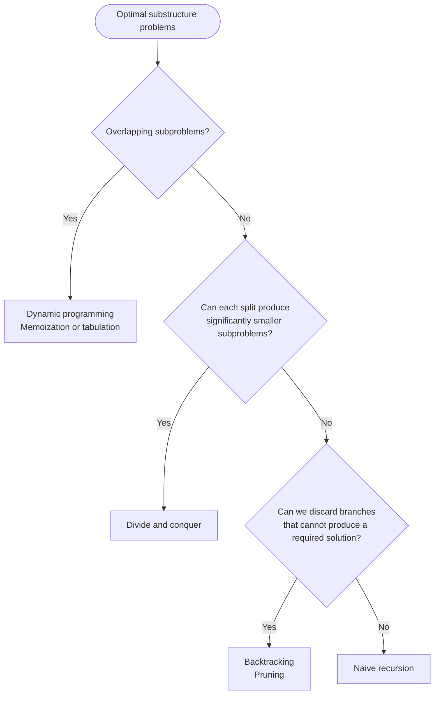

# Optimal Substructure

A problem has optimal substructure when an optimal solution can be built from optimal solutions to its subproblems.
For example, each subpath of a shortest path must also be a shortest path between its endpoints.

Recursion is a broader idea: express a solution in terms of solutions to smaller or simpler subproblems.
It is also useful for tasks without an optimization objective, such as computing Fibonacci numbers.
The diagram provides a starting point for choosing a technique.



When developing a solution, work backward from a simple recursive implementation and consider which optimizations apply.
The branches are a guide, and these techniques can be combined.
These techniques are covered in later chapters.

## Recursion

Recursion is often the most natural way to implement solutions to problems with optimal substructure.

A terminating recursive algorithm needs two parts:

1. Base case: Return a direct answer without another recursive call.
2. Recursive case: Reduce the problem and make progress toward a base case.

Fibonacci numbers provide a simple example of a recurrence relation: `F(0) = 0`, `F(1) = 1`, and `F(n) = F(n - 1) + F(n - 2)` for `n >= 2`.
Naive recursion recomputes the same values many times.
Dynamic programming avoids that repeated work by reusing subproblem results.

```python
...

def fibonacci(n: int) -> int:
    """
    Return the nth Fibonacci number for a nonnegative integer n.

    TC: O(2^N), a simple exponential upper bound.
    SC: O(N) call-stack space.
    """

    if n < 0:
        raise ValueError("n must be nonnegative")

    # Base case
    if n <= 1:
        return n

    # Recursive case: solve both smaller subproblems without caching their results.
    return fibonacci(n - 1) + fibonacci(n - 2)


fibonacci(0) # Returns: 0
fibonacci(1) # Returns: 1
fibonacci(10) # Returns: 55
```

This implementation is intended for small inputs because its running time grows exponentially.
The call stack follows one active chain at a time, so its maximum depth is linear even though the total number of calls is exponential.

Some tips for recursion:

- Always define the base case before writing the recursive case.
  Check that every recursive path makes progress toward it.
  A missing or unreachable base case can cause unbounded recursion until Python raises `RecursionError`.
  Even correct recursion can exceed Python's recursion-depth limit on deep inputs.
- Draw the call tree to reveal repeated subproblems and branches that can be pruned.
- Recursive solutions carry an implicit space cost from the call stack, even when no auxiliary data structures are used.
- Choose recursion when it makes the subproblem structure easier to express.
  An iterative solution can avoid recursive function-call overhead and recursion-depth limits.

For example, reversing a linked list recursively uses O(N) call-stack space, while the usual iterative approach uses O(1) auxiliary space.

- [LeetCode 206. Reverse Linked List](https://leetcode.com/problems/reverse-linked-list)
