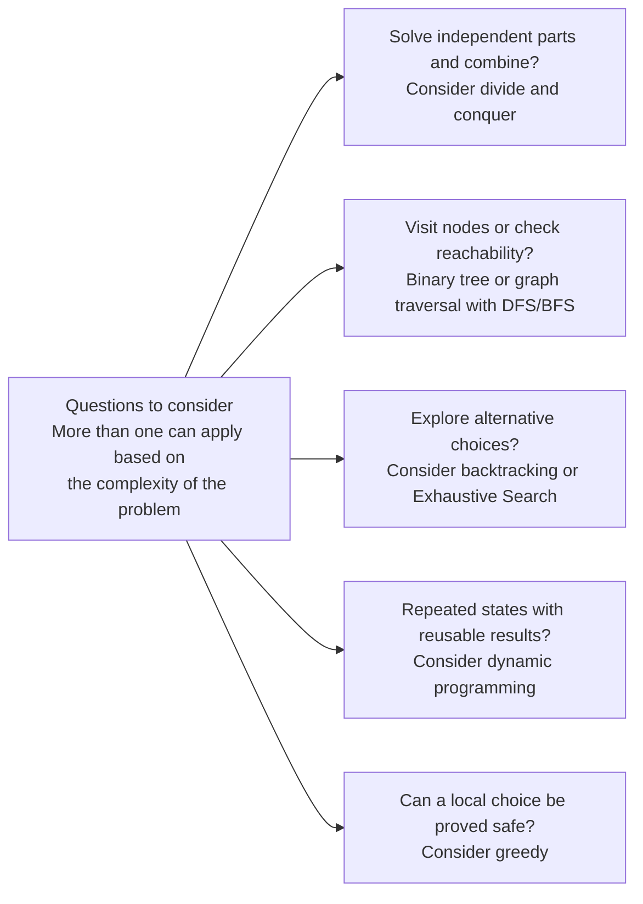

# Recursion and Subproblems

## Recursion

Recursion is often a natural way to solve a problem using solutions to smaller subproblems.

A terminating recursive algorithm needs two parts:

1. Base case: Return a direct answer without another recursive call.
2. Recursive case: Reduce the problem and make progress toward a base case.

A recurrence relation defines a value using values for smaller inputs.
For Fibonacci numbers, `F(0) = 0`, `F(1) = 1`, and `F(n) = F(n - 1) + F(n - 2)` for `n >= 2`.
For example, `F(5) = F(4) + F(3) = 3 + 2 = 5`.
Computing a Fibonacci number asks for a fixed value, so there is no **best solution** to choose.

This recursive implementation recomputes the same values many times.
Dynamic programming avoids that repeated work by reusing subproblem results.

```python
...

def fibonacci(n: int) -> int:
    """
    Return the nth Fibonacci number for a nonnegative integer n.

    TC: O(2^N), a simple exponential upper bound.
    SC: O(N) call-stack space.
    """

    if n < 0:
        raise ValueError("n must be nonnegative")

    # Deep recursion can exceed Python's recursion-depth limit.
    # Base case
    if n <= 1:
        return n

    # Recursive case: solve both smaller subproblems without caching their results.
    return fibonacci(n - 1) + fibonacci(n - 2)


fibonacci(0) # Returns: 0
fibonacci(1) # Returns: 1
fibonacci(10) # Returns: 55
```

This implementation is intended for small inputs because its running time grows exponentially.
The call stack follows one active chain at a time, so its maximum depth is linear even though the total number of calls is exponential.

Some tips for recursion:

- Always define the base case before writing the recursive case.
  Check that every recursive path makes progress toward it.
  A missing or unreachable base case can cause unbounded recursion until Python raises `RecursionError`.
- Draw the call tree to reveal repeated subproblems and branches that can be pruned.
- Recursive solutions carry an implicit space cost from the call stack, even when no auxiliary data structures are used.
- Choose recursion when it makes the subproblem structure easier to express.
  An iterative solution can avoid recursive function-call overhead and recursion-depth limits.

For example, reversing a linked list recursively uses O(N) call-stack space, while the usual iterative approach uses O(1) auxiliary space.

- [LeetCode 206. Reverse Linked List](https://leetcode.com/problems/reverse-linked-list)

## Subproblems

Many problems can be solved by breaking them into smaller or simpler subproblems.
The diagram introduces techniques covered in Chapters 08–13.



Start with a correct solution, then consider which techniques can improve it.
The questions are independent, and these techniques can be combined.
For example, a graph problem can use DFS with memoization.

### Optimal Substructure

A problem has optimal substructure when a **best solution** can be built from **best solutions** to its subproblems.

Minimum, maximum, shortest, and longest questions are natural places to check for optimal substructure (however, having optimal substructure does not automatically mean you should use dynamic programming).
Optimal substructure also applies to some problems solved through divide and conquer, backtracking, or exhaustive search.

```python
...

from typing import List


def coin_change(coins: List[int], amount: int) -> int:
    """
    Return the fewest coins needed to make amount, or -1 if impossible.
    Each coin can be used any number of times.
    Coins must be positive integers, and amount must be nonnegative.

    TC: Exponential in the worst case without memoization.
    SC: O(amount + 1) call-stack space.
    """

    if amount < 0 or any(coin <= 0 for coin in coins):
        raise ValueError("coins must be positive and amount must be nonnegative")

    def rec(rem: int) -> int:
        # Deep recursion can exceed Python's recursion-depth limit.
        # Base case: no coins are needed for a remaining amount of zero.
        if rem == 0:
            return 0

        min_cnt = amount + 1
        for coin in coins:
            if coin <= rem:
                # Choose one coin, then find the fewest coins for the remainder.
                cnt = rec(rem - coin)
                if cnt != -1:
                    min_cnt = min(min_cnt, 1 + cnt)

        return -1 if min_cnt == amount + 1 else min_cnt

    return rec(amount)


coin_change([1, 3, 4], 6) # Returns: 2 => 3 + 3
coin_change([2], 3) # Returns: -1
coin_change([1, 3, 4], 0) # Returns: 0
```
