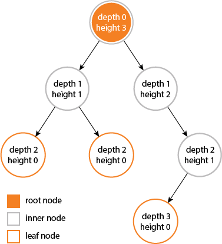
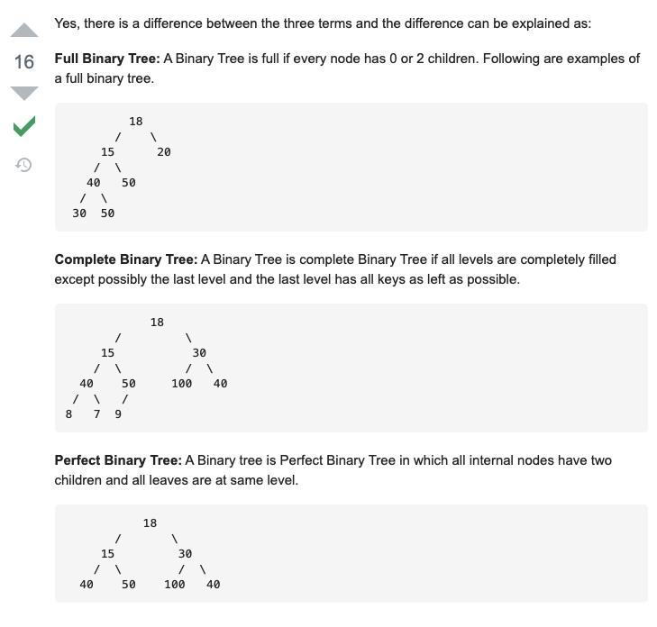

# Binary Tree

A binary tree has at most two children per node.

- Root node:
  The node with no parent.
- Leaf node:
  A node with no children.
- Depth and height:
  A node's depth is the number of edges from the root to that node.
  Its height is the number of edges on its longest downward path to a leaf.
  The root has depth 0, and a leaf has height 0.
  For a nonempty tree, the tree's height is the root's height and equals the maximum node depth.

  

  - [LeetCode 110. Balanced Binary Tree](https://leetcode.com/problems/balanced-binary-tree)
- Types of binary trees:

  

  Binary heaps are complete binary trees.
  Binary search trees are not necessarily complete.
  A nonempty perfect binary tree of height `h` contains `2^(h + 1) - 1` nodes and `2^h` leaf nodes.

Binary tree problems often use subtrees as subproblems.
Traversals determine the order in which nodes are processed.

## Traversal

Most binary tree problems provide a root node and require traversing the tree.
The examples below return node values in traversal order and return an empty list for an empty tree.

```python
from __future__ import annotations

from collections import deque
from typing import Any, List, Optional


"""
N = number of nodes in the tree
H = tree height in edges
W = maximum number of nodes at one level

TC: O(N) for every traversal.
SC for depth-first traversals: O(H + 1) for the call stack or explicit stack.
SC for level-order traversal: O(W) for the queue.
All returned lists use O(N) space.
"""

class TreeNode:
    def __init__(self, val: Any, lft: Optional[TreeNode], rgt: Optional[TreeNode]) -> None:
        self.val = val
        self.lft = lft
        self.rgt = rgt


def inorder_recursive(rt: Optional[TreeNode]) -> List[Any]:
    # Inorder: left subtree, node, right subtree.
    # Recursive traversals can exceed Python's recursion-depth limit on deep trees.
    res = list()

    def rec(tnd: Optional[TreeNode]) -> None:
        if tnd is None:
            return

        rec(tnd.lft)
        res.append(tnd.val)
        rec(tnd.rgt)

    rec(rt)
    return res


def inorder_iterative(rt: Optional[TreeNode]) -> List[Any]:
    # Inorder: left subtree, node, right subtree.
    res = list()
    stk = deque()
    cur = rt
    while stk or cur:
        while cur:
            stk.append(cur)
            cur = cur.lft
        cur = stk.pop()
        res.append(cur.val)
        cur = cur.rgt
    return res


def preorder_recursive(rt: Optional[TreeNode]) -> List[Any]:
    # Preorder: node, left subtree, right subtree.
    res = list()

    def rec(tnd: Optional[TreeNode]) -> None:
        if tnd is None:
            return

        res.append(tnd.val)
        rec(tnd.lft)
        rec(tnd.rgt)

    rec(rt)
    return res


def preorder_iterative(rt: Optional[TreeNode]) -> List[Any]:
    # Preorder: node, left subtree, right subtree.
    if rt is None:
        return list()

    res = list()
    stk = deque()
    stk.append(rt)
    while stk:
        cur = stk.pop()
        res.append(cur.val)

        # Push right first so that left is processed first.
        if cur.rgt:
            stk.append(cur.rgt)
        if cur.lft:
            stk.append(cur.lft)
    return res


def postorder_recursive(rt: Optional[TreeNode]) -> List[Any]:
    # Postorder: left subtree, right subtree, node.
    res = list()

    def rec(tnd: Optional[TreeNode]) -> None:
        if tnd is None:
            return

        rec(tnd.lft)
        rec(tnd.rgt)
        res.append(tnd.val)

    rec(rt)
    return res


def postorder_iterative(rt: Optional[TreeNode]) -> List[Any]:
    # Postorder: left subtree, right subtree, node.
    if rt is None:
        return list()

    res = list()
    stk = deque()
    cur = rt
    last = None
    while stk or cur:
        if cur:
            stk.append(cur)
            cur = cur.lft
        else:
            pkd = stk[-1]
            if pkd.rgt and last is not pkd.rgt:
                cur = pkd.rgt
            else:
                res.append(pkd.val)
                last = stk.pop()
    return res


def levelorder(rt: Optional[TreeNode]) -> List[Any]:
    # Level order: each level from left to right, starting at the root.
    if rt is None:
        return list()

    res = list()
    que = deque()
    que.append(rt)
    while que:
        size = len(que) # Number of nodes in the current level.
        while size > 0:
            pld = que.popleft()
            res.append(pld.val)
            if pld.lft:
                que.append(pld.lft)
            if pld.rgt:
                que.append(pld.rgt)
            size -= 1
    return res


rt = TreeNode(
    4,
    TreeNode(2, TreeNode(1, None, None), TreeNode(3, None, None)),
    TreeNode(5, None, None),
)
inorder_recursive(rt) # Returns: [1, 2, 3, 4, 5]
preorder_iterative(rt) # Returns: [4, 2, 1, 3, 5]
postorder_iterative(rt) # Returns: [1, 3, 2, 5, 4]
levelorder(rt) # Returns: [4, 2, 5, 1, 3]
levelorder(None) # Returns: []
```

Depth-first traversals use O(logN) auxiliary space on a balanced tree and can use O(N) on a skewed tree.

Some problems ask you to construct or transform a binary tree.
Divide and conquer can construct a height-balanced binary search tree from a sorted list.

- [LeetCode 108. Convert Sorted Array to Binary Search Tree](https://leetcode.com/problems/convert-sorted-array-to-binary-search-tree)
- [LeetCode 226. Invert Binary Tree](https://leetcode.com/problems/invert-binary-tree)

With distinct node values, inorder together with either preorder or postorder uniquely determines a binary tree.
Reconstruction does not require a sorted inorder sequence.

- [LeetCode 105. Construct Binary Tree from Preorder and Inorder Traversal](https://leetcode.com/problems/construct-binary-tree-from-preorder-and-inorder-traversal)

Inorder alone, or preorder together with postorder, does not guarantee a unique binary tree.
For example, a root with one child has the same preorder and postorder sequences whether that child is on the left or right.

- [LeetCode 889. Construct Binary Tree from Preorder and Postorder Traversal](https://leetcode.com/problems/construct-binary-tree-from-preorder-and-postorder-traversal)

Preorder or postorder traversal can encode a tree's shape when every missing child is recorded with an explicit null marker.
Use unambiguous value encodings and a null marker that cannot be confused with a node value.

- [LeetCode 572. Subtree of Another Tree](https://leetcode.com/problems/subtree-of-another-tree)
- [LeetCode 652. Find Duplicate Subtrees](https://leetcode.com/problems/find-duplicate-subtrees)

[Morris inorder traversal](https://www.youtube.com/watch?v=wGXB9OWhPTg) uses O(1) auxiliary space by temporarily threading pointers through the tree and restoring them afterward.
Collecting all visited values still takes O(N) output space.
