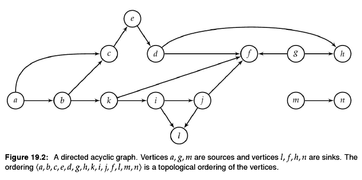
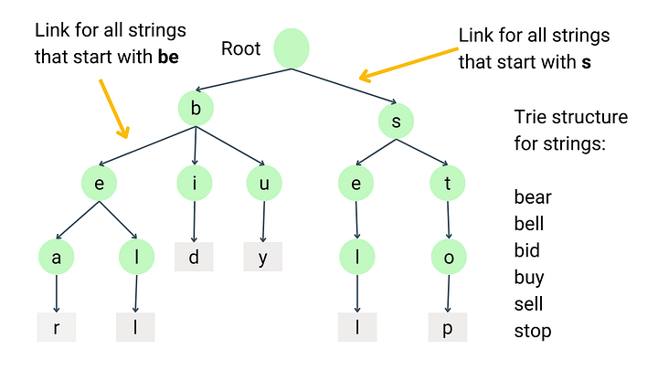
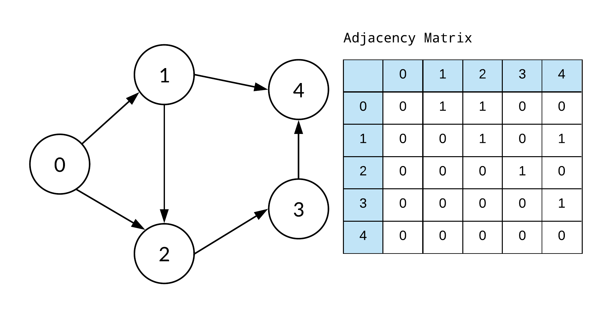

# Graph

- Vertex:
  A node in the graph.
- Connected:
  An undirected graph is connected if a path joins every pair of vertices.
- Edge:
  A connection between two vertices.
  A nonempty undirected tree has `|V| - 1` edges; connected graphs can have more edges when cycles exist.
  Weighted graphs assign costs to edges, which may be positive, zero, or negative.
  Unweighted graphs treat all edges as having equal cost.

Traversals explore vertices and their connections.
Graphs generalize trees and may contain cycles, disconnected components, or multiple paths between vertices.

In the adjacency-set examples below, every vertex must be a dictionary key, including vertices with no neighbors.
The mappings store unweighted edges and use hashable vertex labels.

## Categories & Must-Knows

- Undirected Graph:
  Edges have no direction, so each edge can be traversed both ways.

  - Disjoint Set (Union Find):
    A data structure that groups vertices into connected components of an undirected graph.

    ```python
    ...
    
    from typing import Any, Dict, Set
    
    
    class DisjointSet:
        """
        Use path compression and union by rank.

        TC: O(alpha(|V|)) amortized per find or union, where alpha is the inverse Ackermann function.
        SC: O(|V|).
        """

        def __init__(self, gph: Dict[Any, Set[Any]]) -> None:
            self.vtx_to_par = {vtx: vtx for vtx in gph}
            self.vtx_to_rnk = {vtx: 0 for vtx in gph}
            for vtx, nbrs in gph.items():
                for nbr in nbrs:
                    self.union(vtx, nbr)
    
        def union(self, vtx1: Any, vtx2: Any) -> None:
            par1 = self.find(vtx1)
            par2 = self.find(vtx2)
            if par1 != par2:
                if self.vtx_to_rnk[par1] > self.vtx_to_rnk[par2]:
                    self.vtx_to_par[par2] = par1
                elif self.vtx_to_rnk[par1] < self.vtx_to_rnk[par2]:
                    self.vtx_to_par[par1] = par2
                else:
                    self.vtx_to_par[par2] = par1
                    self.vtx_to_rnk[par1] += 1
    
        def find(self, vtx: Any) -> Any:
            par = self.vtx_to_par[vtx]
            if par != vtx:
                par = self.find(par)
                self.vtx_to_par[vtx] = par
            return par
    ```

    For cycle detection, initialize isolated vertices and process each undirected edge once.
    An edge creates a cycle if its endpoints already have the same representative.
    An acyclic undirected graph is a forest; it is a tree when it is also connected and nonempty.

    - [LeetCode 684. Redundant Connection](https://leetcode.com/problems/redundant-connection)

- Directed Graph:
  Each edge has a direction from one vertex to another.

  - Topological Sort:
    Order the vertices so that every directed edge goes from an earlier vertex to a later one.
    A complete topological ordering exists exactly when the graph is a directed acyclic graph, or DAG.

    

    ```python
    ...
    
    from collections import deque
    from typing import Any, Dict, List, Set
    
    
    def top_sort(gph: Dict[Any, Set[Any]]) -> List[Any]:
        """
        Use Kahn's algorithm to order vertices by their dependencies.

        TC: O(|V| + |E|).
        SC: O(|V|) auxiliary space, plus O(|V|) for the result.
        """
    
        # Count incoming edges for every vertex.
        vtx_to_indeg = {vtx: 0 for vtx in gph}
        for nbrs in gph.values():
            for nbr in nbrs:
                vtx_to_indeg[nbr] += 1
    
        # Start with vertices that have no incoming edges.
        que = deque([vtx for vtx in gph if vtx_to_indeg[vtx] == 0])
    
        # Remove outgoing edges and enqueue each neighbor when its indegree reaches zero.
        top_sorted = list()
        while que:
            start = que.popleft()
            top_sorted.append(start)
            for nbr in gph[start]:
                vtx_to_indeg[nbr] -= 1
                if vtx_to_indeg[nbr] == 0:
                    que.append(nbr)
    
        # A cycle leaves some vertices with incoming edges, so they are never processed.
        if len(top_sorted) != len(gph):
            raise ValueError('Cycle detected in graph')
    
        return top_sorted
    ```

    Topological sorting is useful for dependency scheduling and directed-cycle detection.
    A DAG is not necessarily a tree; it can have multiple parents or disconnected components.

    - [LeetCode 207. Course Schedule](https://leetcode.com/problems/course-schedule)
    - [LeetCode 269. Alien Dictionary](https://leetcode.com/problems/alien-dictionary)

  - Trie:
    A tree that stores strings by their shared prefixes.

    

    ```python
    ...
    
    class Trie:
        class _Node:
            def __init__(self) -> None:
                self.ch_to_node = dict()
                self.end = False
    
        def __init__(self) -> None:
            self._rt = self._Node()
    
        def insert(self, txt: str) -> None:
            cur = self._rt
            for ch in txt:
                if ch not in cur.ch_to_node:
                    cur.ch_to_node[ch] = self._Node()
                cur = cur.ch_to_node[ch]
            cur.end = True
    
        def starts_with(self, pfx: str) -> bool:
            cur = self._rt
            for ch in pfx:
                if ch not in cur.ch_to_node:
                    return False
                cur = cur.ch_to_node[ch]
            return True
    
        def longest_prefix(self) -> str:
            # Return the longest prefix shared by all inserted strings.
            pfx = list()
            cur = self._rt
            while not cur.end and len(cur.ch_to_node) == 1:
                ch, cur = next(iter(cur.ch_to_node.items()))
                pfx.append(ch)
            return ''.join(pfx)


    trie = Trie()
    trie.insert('flower')
    trie.insert('flow')
    trie.starts_with('flo') # Returns: True
    trie.starts_with('fly') # Returns: False
    trie.longest_prefix() # Returns: 'flow'
    ```

    Insertion and prefix lookup take O(L) expected time for L characters, assuming constant-time dictionary operations.
    Finding the common prefix takes O(P + 1) time for P returned characters.
    The trie uses space proportional to the number of distinct nonempty prefixes, plus its root node.

    - [LeetCode 208. Implement Trie](https://leetcode.com/problems/implement-trie-prefix-tree)
    - [LeetCode 14. Longest Common Prefix](https://leetcode.com/problems/longest-common-prefix)

## Representation

- Adjacency Matrix:
  Store edge information in a `|V| x |V|` matrix, using O(|V|^2) space.
  In an unweighted graph, a cell is 1 when an edge exists and 0 otherwise.

  

  - [LeetCode 1615. Maximal Network Rank](https://leetcode.com/problems/maximal-network-rank)

- Adjacency Set:
  Map each vertex to its set of neighbors, using O(|V| + |E|) space.
  Include vertices with no neighbors as keys with empty sets.

  ```python
  ...
  
  gph = {
      'a': {'b', 'c', 'd'},
      'b': {'e', 'f'},
      'c': set(),
      'd': set(),
      'e': set(),
      'f': set(),
  }
  ```

For an undirected graph, record each edge in both endpoints' neighbor sets.
For a directed edge `u -> v`, add `v` only to `u`'s neighbor set.
When only edges are provided, build an adjacency matrix or an adjacency set and include any known isolated vertices.
Set iteration order is not guaranteed, so valid traversal or topological orders may differ.

- [LeetCode 207. Course Schedule](https://leetcode.com/problems/course-schedule), also mentioned in the topological sort section above.

## Search

The following searches visit only vertices reachable from `start`.
The starting vertex must be a key in `gph`.
Their auxiliary space bounds exclude graph storage and the returned list, which uses O(|V|) space.
With an adjacency matrix, scanning neighbors can increase the search time to O(|V|^2).

- Depth First Search (DFS):
  Explore a path before backtracking, using recursion or an explicit stack.
  Trees are connected graphs without cycles, and DFS extends their preorder and postorder traversals to general graphs.
  Graph traversals use `seen` to avoid revisiting vertices through cycles or multiple paths.

  ```python
  from collections import deque
  from enum import Enum, auto
  from typing import Any, Dict, List, Set


  class SearchMethod(Enum):
      ITERATIVE = auto()
      RECURSIVE = auto()
  
  
  def depth_first_search(gph: Dict[Any, Set[Any]], start: Any, method: SearchMethod) -> List[Any]:
      """
      Visit each reachable vertex once in depth-first discovery order.

      TC: O(|V| + |E|).
      SC: O(|V|) auxiliary space.
      """
  
      res = list()
      seen = set()

      def rec(vtx: Any) -> None:
          # Deep paths can exceed Python's recursion-depth limit.
          if vtx in seen:
              return
  
          seen.add(vtx)
          res.append(vtx)
          for nbr in gph[vtx]:
              rec(nbr)
  
      def itr(vtx: Any) -> None:
          seen.add(vtx)
          res.append(vtx)
          stk = deque([iter(gph[vtx])])
          while stk:
              # Keep each active vertex's iterator to finish its subtree before returning.
              for nbr in stk[-1]:
                  if nbr in seen:
                      continue
  
                  seen.add(nbr)
                  res.append(nbr)
                  stk.append(iter(gph[nbr]))
                  break
              else:
                  stk.pop() # This vertex has no unvisited neighbors left.
  
      if method is SearchMethod.RECURSIVE:
          rec(start)
      elif method is SearchMethod.ITERATIVE:
          itr(start)
      else:
          raise TypeError('method must be a SearchMethod')
      return res
  ```

  - [LeetCode 200. Number of Islands](https://leetcode.com/problems/number-of-islands)

- Breadth First Search (BFS):
  Use a queue to visit vertices in increasing distance from the start.
  BFS finds shortest paths measured in edge count in an unweighted graph.
  It generalizes level-order tree traversal.

  ```python
  ...
  
  from collections import deque
  from typing import Any, Dict, List, Set
  
  
  def breadth_first_search(gph: Dict[Any, Set[Any]], start: Any) -> List[Any]:
      """
      Visit each reachable vertex once in increasing distance from start.

      TC: O(|V| + |E|).
      SC: O(|V|) auxiliary space.
      """
  
      res = list()
      seen = set()

      que = deque()
      seen.add(start)
      que.append(start)
      while que:
          cur = que.popleft()
          res.append(cur)
          for nbr in gph[cur]:
              if nbr in seen:
                  continue
  
              seen.add(nbr)
              que.append(nbr)
      return res
  ```

  - [LeetCode 322. Coin Change](https://leetcode.com/problems/coin-change)
  - [LeetCode 934. Shortest Bridge](https://leetcode.com/problems/shortest-bridge)

## Advanced Graph Topics

Explore these topics after the basics if your interview preparation allows time.

[Dijkstra's algorithm](https://www.youtube.com/watch?v=lAXZGERcDf4&t=21s) finds shortest paths with nonnegative edge weights.
Shortest paths have optimal substructure: each part of a shortest path is also a shortest path between its endpoints.
Otherwise, replacing that part with a shorter path would shorten the whole path.
With nonnegative weights, Dijkstra can safely finalize the unvisited vertex with the smallest distance found so far.

[Bellman-Ford](https://www.youtube.com/watch?v=-mOEd_3gTK0) allows negative edge weights and can detect negative cycles reachable from the source.
For bounded-stop problems, track the edge budget in the search state.
A limit of K intermediate stops permits at most K + 1 edges.
With Bellman-Ford, use at most K + 1 rounds, with each round reading distances from the previous round and writing to a separate copy.
Updating distances in place can chain several edges within one round and exceed the budget.

- [LeetCode 787. Cheapest Flights Within K Stops](https://leetcode.com/problems/cheapest-flights-within-k-stops)

[A\*](https://www.youtube.com/watch?v=vP5TkF0xJgI&t=99s) prioritizes paths using the cost so far plus a heuristic estimate of the remaining cost.
For a standard implementation that never reopens expanded vertices, a consistent heuristic guarantees optimality.

- [LeetCode 1091. Shortest Path in Binary Matrix](https://leetcode.com/problems/shortest-path-in-binary-matrix)

Minimum Spanning Trees:
Connect all vertices of a connected, weighted, undirected graph with minimum total edge weight.
Every spanning tree has `|V| - 1` edges.
When every edge has weight 1, all spanning trees have the same total cost.
For a disconnected graph, the corresponding problem is a minimum spanning forest.
[Kruskal's algorithm](https://www.youtube.com/watch?v=fAuF0EuZVCk) and [Prim's algorithm](https://www.youtube.com/watch?v=oP2-8ysT3QQ) are greedy algorithms for the undirected problem.

- [LeetCode 1584. Min Cost to Connect All Points](https://leetcode.com/problems/min-cost-to-connect-all-points)
